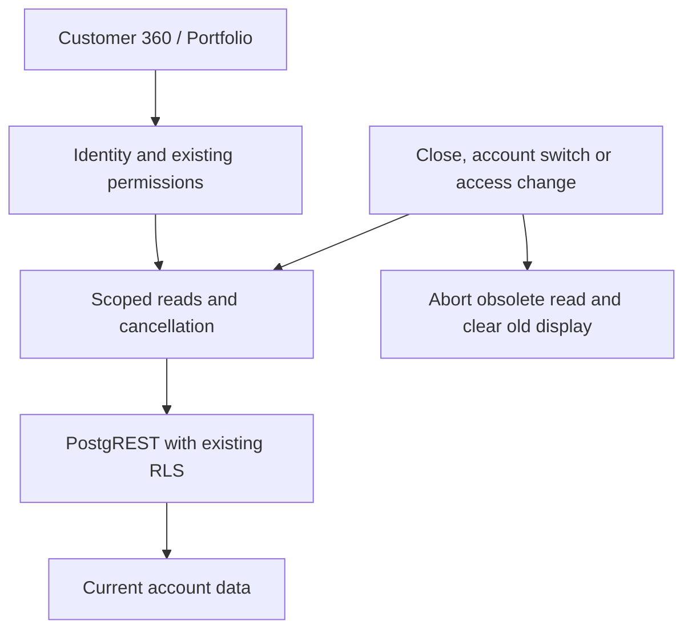

# KC CuTo CRM: Skill audit, minimal fix and verification

Date: 1 November 2026 (Asia/Bangkok). Baseline: `6ffaee7` (#188). Scope: Customer 360 core/secondary tabs, portfolio, shared REST admission, access invalidation and notification lifecycle. Source stack: React ESM, Supabase JS/PostgREST, RLS, Edge Functions, GitHub Pages. This is a bounded source/DB read-only audit plus targeted frontend fixes, not a claim to have verified every CRM feature or external provider.

Applied uploaded skills: Code & Flow Tracer → Debug & Fix → Safe Refactor review, KAI-COM Supabase Performance and Ponytail. No new package, backend mutation, schema/index/configuration change or production data mutation was needed. Reused the existing read coordinator rather than introducing another cache/request abstraction. No unrelated cleanup or pure refactor was mixed into the fix.

## Flow matrix and evidence

| Flow | Entry / chain | Data and permission boundary | Result |
|---|---|---|---|
| F1 Account open | `internal-workspace.mjs` → `customer360.mjs` → `customerGroup/loadCustomerSources` | Selected customer/group IDs, existing module permissions, source RLS | CONFIRMED source + loader tests; add cancellation on close/switch |
| F2 Secondary tabs | Records/Timeline/Identity/Communications → `readCustomerPages` | Lazy, existing scoped filters and RLS; no writes | CONFIRMED; stop obsolete pagination |
| F3 Portfolio | Accounts → `customer360-portfolio.mjs` → health-signals view | Existing actor identity/RLS, server filters and 25-row pages | CONFIRMED; use shared coordinator, access reset and abort |
| F4 Shared reads | `read-coordinator.mjs` → `rest-read-policy.mjs` | Session/role keys, 5 concurrent reads, 60/300-second REST TTL, cancellation/dedup | CONFIRMED unit tests, not live HAR latency measurement |
| F5 Notifications | Shared notification store → notifications; hourly private customer health job | Active job `15 * * * *`; RLS on notifications | CONFIRMED source/tests and read-only production metadata; no live notifications sent in this audit |

## Findings and fixes

| ID | Priority | Confirmed behavior before | Minimal fix | Regression evidence |
|---|---|---|---|---|
| C360-01 | P2 | Portfolio close/filter change left the network request running | Existing shared `observeRead` attaches and cancels AbortSignal | Lifecycle test RED → GREEN |
| C360-02 | P2 | Access-change event did not clear already displayed portfolio/core account data | Coordinator access reset plus core invalidation; broader existing `readIdentity` dependencies | Portfolio and core access tests RED → GREEN |
| C360-03 | P2 | Cancelled page loop continued through 40 synthetic pages to its 20,000-record guard | Optional AbortSignal checked before/after each page and passed through core/secondary callers | Cancelled-pagination test RED → GREEN, one request |
| BASE-01 | Test gap | Six local test files lack PGlite; one lacks sanitize-html | No app dependency or product patch added merely to hide missing test prerequisites; CI installs its declared test dependencies | Seven local files BLOCKED |
| BASE-02 | Test gap | Lead duplicate review mock and sales dashboard context mock fail at baseline | Kept outside the targeted source patch; no evidence of a new product failure from these assertions | Same two baseline assertions fail after patch |

Source references: `src/customer360-loader.mjs:7`, `src/customer360.mjs:25`, `src/customer360.mjs:37`, `src/customer360-portfolio.mjs:1`, `src/read-coordinator.mjs:1`, `src/rest-read-policy.mjs:1`. Tests: `tests/customer360-loader-cancel.test.mjs`, `tests/customer360-portfolio-lifecycle.test.mjs`.

## Before / after measurements

| Measurement | Before | After | Evidence / limit |
|---|---:|---:|---|
| Portfolio request aborted when closed | 0 | 1 | Isolated component lifecycle regression |
| Display removed on access invalidation | No | Yes | Portfolio/core synthetic display tests |
| Requests in cancelled 500-row pagination fixture | 40 | 1 | Unit reproduction; not production traffic counts |
| Targeted regression suite | RED for 4 new cases | 63 passed, 0 failed | Customer360, health, read coordinator, REST policy, notification store |
| Broad local baseline | 481 pass / 9 fail (490 tests) | 485 pass / same 9 fail (494 tests) | 120 → 122 test files; seven missing dependency files, two existing mock failures |
| Production DB connection snapshot | 15 backends: 1 active, 13 idle, 1 unknown | Not changed | Single snapshot, not peak capacity or Supavisor frontend count |
| RLS on selected six tables | Enabled | Not changed | Read-only metadata audit |
| Cold/warm live API counts, LCP, p95, bytes, CPU/RAM | NOT MEASURED | NOT MEASURED | No invented speed improvement or capacity claim |

Portfolio remains event-driven: `interval: Infinity` adds no periodic polling. Closed/hidden/offline panels do not start reads; shared access events discard stale data and shared REST rules retain safe read backoff. Mutations continue to bypass the read queue; no money/status/ID/approval/stock/email behavior is changed by this frontend patch.

## Data integrity and release

No production business rows were modified during this audit. No SQL migration, index or pool setting changed. RLS enabled metadata is not a substitute for a complete live role matrix. Synthetic source tests cover role/access invalidation, but all real employee roles and external Microsoft/LINE/MOC integration are UNVERIFIED in this audit. Existing external provider limitations remain as documented in `customer360-completeness.md`.

Rollback: revert this frontend PR and republish the prior release. No database rollback/backfill is required. Browser regression must verify the existing bilingual desktop/mobile Customer 360 workflows before merge. Deployment/pipeline evidence belongs in the PR; no claim of deployment is made from source changes alone.
