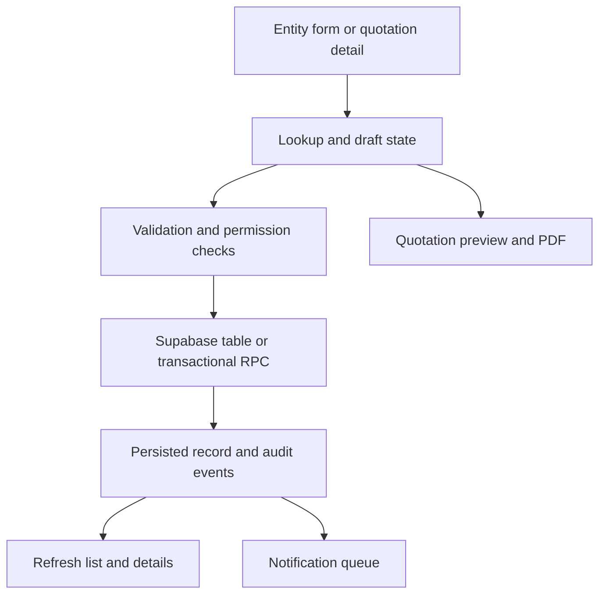

# KC CuTo CRM QA — 26 October 2026

Repository: aukkarapornsiri/KC-CuTo-CRM.
Baseline: main a981ef560469f5cb48a640d73448640072a4b488.
Working branch: fix/qa-oct26. Release candidate: 20261026-qa-repair.

Requested order: Code & Flow Tracer → Debug & Fix → repository Browser Smoke Test → Safe Refactor review. Tests use isolated browser Demo records; no production database writes, real email sends or Netcube imports.

## Trace and confidence

Static SPA React bundle imports feature modules. Supabase handles authenticated reads, RLS-protected writes and transactional RPCs. CONFIRMED below means source inspected and/or isolated test evidence, not production runtime certification.

| Flow | Entry → handler → persistence/side effect | Evidence and limits |
|---|---|---|
| Leads, contacts, accounts, activities, documents | Navigation → internal-workspace start/save/read → entity relations, validated form → Supabase table/RPC → read-back | CONFIRMED Demo E2E covers 13 entity forms, create/edit/read-back/search/export at 1440/390px. Production role matrix UNVERIFIED. |
| Quotations | Detail Print/Save PDF → start(selected) → QuotationDialog → template/customer/contact data → preview/print | CONFIRMED regression reproduced null dereference, then desktop/mobile preview and contact suites pass. |
| Product creation within quotation | ProductPicker → validated unit from masters → saveQuotePrice → shared Demo product records / live API | CONFIRMED Demo master-data loading defect; fixed without weakening validation. Production path unchanged. |
| Sales orders | Approved quotation → PO creation → SO approval → delivery → completion/cancel | CONFIRMED Demo smoke; test now asserts delivery unavailable before SO approval. Live RPC/RLS UNVERIFIED by this session. |
| Approval | Public quotation transition wrapper → private approval transition → state/audit/notifications | Source inspected in db/internal-processes.sql. Live deployed migration parity and all roles UNVERIFIED. |
| Reads and refresh | rest-read-policy queue → authenticated cache/dedup → response → invalidation on writes | CONFIRMED unit tests. Bounded read concurrency, backoff and write bypass remain unchanged. |
| Notifications/email | notification-store user-scoped visible-tab polling; assignment queue → service-role claim/group → worker | CONFIRMED isolated unit/PGlite tests. Claim restricted to service_role; live email delivery and provider deduplication UNVERIFIED. |

SO observed transitions: approved quotation → confirmed SO with pending approval → approved SO → delivered → completed; cancellation is separately tested. No status or permission rule was relaxed.

## Findings and minimal fixes

1. **P1, CONFIRMED: quotation preview crashes for a historical row with omitted customer_id.** In src/quotation-document.mjs the expression `liveCustomer?.id === editing.customer_id` compared undefined to undefined, then dereferenced null.contacts (and null.customer). Existing quotation-details-smoke reproduced failure; a diagnostic browser run captured the page error. Both reads now require a non-null liveCustomer. Existing missing-customer fixture is explicitly documented and remains unchanged. RED → GREEN on quotation-details and adjacent quotation-contact suites.
2. **P2, CONFIRMED: Demo inline product creation has no available master unit.** internal-workspace start always supplied an empty masters array in Demo while ProductPicker correctly requires an active master unit. quotation-layout-smoke now explicitly asserts units exist and selects Unit; assertion failed before the fix. Quotations now use the same initialized masterDemo store as Inventory. RED → GREEN on quotation-layout; production master-data query unchanged.
3. **P2, CONFIRMED: smoke scripts lagged intended UI changes.** Updated exact localized labels, bilingual street fixtures, quotation kind choice, shared-template save label, personal signature upload, scoped settings-card selection, and SO approval step. Retained assertions for amounts, persisted values, relationships, cancellation, viewport, signature rendering and permissions gate. No timeout increases or assertion removals to hide failures.

## Verification

- Baseline unit tests: 374 PASS, zero failures/skips.
- After fixes: `node --test tests/*.test.mjs tests/*.test.cjs`: 374 PASS, zero failures/skips.
- `node tests/integration-contract.mjs`: PASS. Bundle and source-module syntax checks: PASS. `git diff --check`: PASS.
- Existing CI baseline run 40276792129: 5/9 matrix groups passed; 4 failed (regression, customer-sales, native-sales-orders, navigation-settings).
- Local baseline: all 29 workflow suites executed; 19 passed, 10 failed. Eight were app/test defects discussed above; PDF environment lacked SwiftShader initially, and general menu smoke reports external resource ERR_EMPTY_RESPONSE.
- After repairs, all 28 suites other than general `smoke` have passing local evidence across baseline and targeted reruns. Affected reruns include internal-workspace, settings-workspace, dashboard-layout, settings, customer360-create, native-sales-orders, quotation-layout, quotation-details, quotation-contact and quotation-print. Internal-workspace passes 13 entity forms and customer/activity workflows at both viewport sizes.
- PDF suite passes short, two-page, many-page, long-item, long-notes, no-code and no-background cases after supplying the browser rendering dependency. Browser is package-provided Chromium; normal Playwright browser download was invalid in this environment.
- General `smoke` traversed all menus but failed on external resource console errors locally. CI is the release gate for that environment-sensitive suite; do not count it as a local pass.
- CI candidate and deployment status are recorded in the PR/Actions; this report alone is not evidence of a production smoke pass.

## Safe Refactor review and invariants

Reviewed shared read/cache, notification, ordering and quotation data selection boundaries after the fixes. No additional structural extraction is justified by this narrow repair; no speculative refactor is included. Any future extraction must use a separate PR with characterization tests, as required by the requested Safe Refactor skill. No maintainability/performance improvement is claimed from this review.

No schema/migration, financial calculation, sequence, API contract, RLS/RBAC or production record change is included. Synthetic read-back, amounts and workflow-gate invariants pass. Live production stored-data integrity was not independently queried: UNVERIFIED. Runtime request counts, latency, bundle performance and render frequency: NOT MEASURED.

Rollback: revert the QA repair merge and restore the prior release ID. No data rollback is required by these source-only changes. Production browser verification remains separate from GitHub Pages deployment success.
