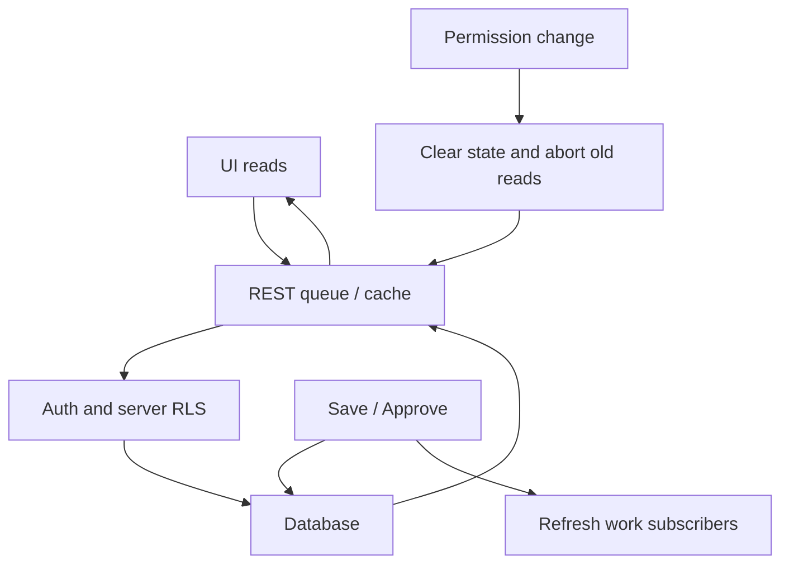

# KC CuTo CRM — Skill-based code and performance review

App: https://kc-cuto.kaicomhub.com/ · Date: 27 October 2026 (Asia/Bangkok).
Initial baseline: `7619d22`; integrated upstream release: `1ccd387` · Supabase: `tocsxnprspiogawignib` · Hosting: GitHub Pages.
Skills applied: Code & Flow Tracer, Debug & Fix, Safe Refactor, KAI-COM WebApp & Supabase Performance.
Scope: shared reads, access changes, notifications, Profile signatures, quotation/SO paths, navigation and print regressions. This is not a claim that every business workflow or external integration has been tested.

## Architecture and traced flows

| Flow | Caller → API → data → output | Evidence and coverage |
|---|---|---|
| Access | RoleAccess Provider → profile SELECT + crm_access_context + role/dashboard permissions → Gate | src/role-access.mjs; auth, permission matrix and coordinator unit tests; live RLS metadata read |
| Shared REST | Supabase custom fetch → REST admission/cache policy → server RLS → consumer | src/rest-read-policy.mjs; deterministic before/after network harness |
| Polling | targets/settings/workflow observers → coordinator → scoped reads → UI | src/read-coordinator.mjs; hidden/offline, dedupe, logout and stale-result tests |
| Notification badge | auth subscription → unread notifications SELECT → shared badge | src/notification-store.mjs; existing visibility and auth tests |
| SO approval | SalesOrders changeApproval → crm_so_approval_action → private transaction/signature trigger → event/audit/notification | src/sales-orders.mjs; live function read; synthetic browser SO workflow; no live approval performed |
| Quotation signature | Profile default → quotation hook → saved template snapshot → PDF | src/profile-signature.mjs and src/quotation-seller-signature.mjs; owner/error/demo characterization and print regressions |

SO state contract remains unchanged: confirmed/pending → approve (active authorized approver plus Profile signature) → approved; reject requires a reason; request after rejection creates a new revision. Delivered/completed/cancelled orders are ineligible for new approval. Client changes do not grant permissions or change financial calculations/document numbers.

## Confirmed findings and fixes

| ID | Priority | Evidence | Applied correction |
|---|---|---|---|
| R1 | P2 | Cancelled queued reads still reached native fetch | Subscriber counting aborts transport when nobody needs it, skips cancelled queue entries and preserves other subscribers |
| R2 | P2 | Breaker recognized 522 only | Handle 429/502/503/504/522; respect seconds/date Retry-After; one recovery probe; no automatic write retry |
| R3 | P1 defense | Access invalidation left cached observer data visible and accepted late transport responses | Clear observer state immediately, abort old generation, reject late responses; preserve failure backoff |
| R4 | P2 | SO approval RPC absent from work-change notification matcher | Emit one work-change event after successful SO approval/rejection RPC; never on a failed write |

Before modification the initial five regression tests for these findings failed; after modification all passed. Additional tests cover all shared subscribers cancelling, fresh replacement subscriptions, failed writes and HTTP-date Retry-After.

## Baseline and results

Synthetic workloads, not production latency claims:

| Metric | Before | After | Measurement |
|---|---:|---:|---|
| Native requests: 5 occupied slots + 1 cancelled queued read | 6 | 5 | rest-read-policy.test.mjs |
| Native requests: first 429 then second read before retry time | 2 | 1 | same deterministic harness; also 502/503/504 |
| Duplicate equivalent simultaneous GET | 1 | 1 | behavior retained |
| Maximum concurrent reads | 5 | 5 | behavior retained |
| General/master cache TTL | 60s/300s | 60s/300s | behavior retained |
| SO approval work-change events after success | 0 | 1 | synthetic POST, no live approval |
| Initial Node regression baseline | 377 passed | 394 passed after upstream integration | full tests/*.test.mjs |
| Production p50/p95, LCP, bytes/page and error rate trend | NOT MEASURED | NOT MEASURED | no authenticated production workload captured |

Cold read/dedup and warm-cache behavior are covered with virtual time; percentages above must not be interpreted as whole-application speed gains.

## Read-only database audit

Snapshot: 20 database backends (1 active, 18 idle, 1 unspecified); 0 transactions older than 60 seconds. Not a peak-load or Supavisor client count.
RLS enabled on all eight selected core tables: profiles, role_permissions, leads, quotations, crm_sales_orders, crm_so_approvals, crm_sales_order_cost_sheets and notifications; 25 policies across those tables. This confirms metadata, not an exhaustive live cross-role access test.
`pg_stat_statements` is installed (1.11). Cumulative query statistics were inspected using IDs and aggregate timings without exposing query text or business rows. These are not before/after production benchmarks.

Existing project-wide advisories remain review items, not proven bottlenecks: 26 foreign keys without covering indexes, 5 auth/RLS initplan warnings, 15 multiple-permissive-policy warnings, 137 unused-index notices. No indexes were added/dropped and no pool settings were changed without a query plan and write-impact evidence. The 47 RLS-without-policy notices include deliberately inaccessible/internal tables. One exposed SECURITY DEFINER function (`crm_assignment_people`) has explicit module/access/eligible-user guards confirmed in its definition; it was not broadened.

Advisory references: [foreign keys](https://supabase.com/docs/guides/database/database-linter?lint=0001_unindexed_foreign_keys), [RLS initplan](https://supabase.com/docs/guides/database/database-linter?lint=0003_auth_rls_initplan), [permissive policies](https://supabase.com/docs/guides/database/database-linter?lint=0006_multiple_permissive_policies), [definer functions](https://supabase.com/docs/guides/database/database-linter?lint=0029_authenticated_security_definer_function_executable).

## Data safety, release and remaining limits

No production business writes, schema changes, backfills, document renumbering or live approval actions were performed. All mutation tests use synthetic local/demo data. Existing RLS and approval functions remain unchanged. Production email delivery, external sync and full real-role/tenant workload testing were NOT RUN.
Release slice: shared read bug fixes. Planned signature-source extraction was already implemented independently upstream in PR #121 (`src/signature-store.mjs`). Preserved that implementation and added owner/error/demo characterization coverage; no redundant refactor or mixed refactor patch is needed.
Rollback: revert the relevant application PR and stamp/deploy a new release; no database rollback is required. Static hosting has no percentage canary, so use branch tests and a staged application release with pipeline checks. Release evidence and final verification are recorded in the corresponding PRs; no production performance improvement is claimed without live measurements.

Official documents checked: Supabase changelog (27 October 2026), onAuthStateChange and Data API security. The upcoming legacy TLS cipher removal concerns unsupported clients and does not require changing this app's SDK or database for this patch.

## Verification details

Local synthetic browser suites passed: native SO (desktop/mobile), workflow map (TH/EN, three widths), quotation print (seven cases), navigation (14 modules, desktop/mobile), login layout (14 viewports), and quotation details. The legacy quotation-layout suite is BLOCKED by stale form-label selectors (Website / Billing Street); temporary test-only selector edits were discarded. It is not claimed as passing. Anonymous database role lacks EXECUTE on SO approval RPC and UPDATE on approval table (read-only privilege check). A follow-up regression also proved and fixed permission invalidation after a write had detached an in-flight request from the dedupe map.

Integrated upstream validation: 394 Node tests passed; integration contract passed. Direct production browser smoke is BLOCKED: Cloudflare renders “Sorry, you have been blocked” for the cloud verification browser. Deployment pipeline success must not be conflated with live UI verification; no security settings were weakened or bypassed.
