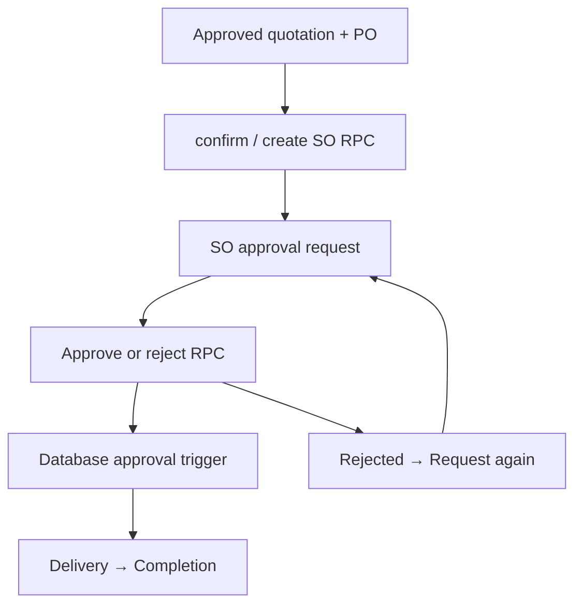

# KC CuTo CRM — Code & Flow Tracer → Debug & Fix → Safe Refactor

Repository: aukkarapornsiri/KC-CuTo-CRM. Source baseline main: 881056f7581fe1b4283de63e3bff6b7347ba6373. Stack: React ES modules, Supabase PostgreSQL/Auth/Storage, GitHub Pages. Reviewed on 2026-10-20 UTC.

## Scope and evidence
Three selected flows: quotation calculation/save, SO conversion/approval/delivery, notification reads. This is not a full application audit. Source blob hashes for sales-orders, record-display, internal-workspace, notification-store, read-coordinator and native SO smoke matched the GitHub baseline exactly. Local detached checkout base was older; remote Git trees were used to preserve intervening production changes.

| Flow | Chain and evidence | Coverage |
|---|---|---|
| Quotation | quotation-document.mjs → quoteTotals in internal-model.mjs → internal-workspace.mjs save → quotations/financial trigger; recurring unit regressions | CONFIRMED source and unit tests; production mutations NOT RUN in this audit |
| SO | internal-workspace.mjs Receive PO action → sales-orders.mjs confirm → crm_create_sales_order_with_details → crm_so_approval_action → crm_transition_sales_order → crm_sales_orders | CONFIRMED source and live read-only function inspection; synthetic browser smoke tracked in PR |
| Notifications | notification-store.mjs subscribe/read → visibility guard, shared in-flight read, 60-second interval, bounded error backoff | CONFIRMED source and unit tests; real email delivery NOT RUN |

## State and permission evidence
- CONFIRMED: sales-orders.mjs canConvertQuotation requires approved approval_status and approved/sent/accepted quote status.
- CONFIRMED: private.crm_so_approval_action checks active authenticated user, create/ownership or approve permission for request, approve permission for review; requires pending review; request is idempotent while pending.
- CONFIRMED: public.crm_transition_sales_order delegates to private.crm_sales_order_transition, which checks permissions, locks the order, verifies updated_at and allowed transitions, writes events/audit.
- CONFIRMED: live trigger crm_so_approved_before_delivery invokes private.crm_so_require_approval before status update and rejects delivered/completed without approved crm_so_approvals. This guard is outside the transition RPC body.
- CONFIRMED: Cost Sheet capture trigger snapshots financials and quotation terms; recurring trigger snapshots quotation_kind/recurring.
- UNVERIFIED: end-to-end production role matrix, actual mail delivery and external integrations. No live customer documents were created, approved or changed in this audit.

## Findings and fixes
| ID | Priority | Root cause / reproduction | Change / status |
|---|---|---|---|
| SO-01 | P3 | sales-orders.mjs list cards rendered raw approvalRows[row.id].status; pending/approved/rejected remained English lowercase on Thai page. Component regression failed before patch. | CONFIRMED; bilingual list labels fixed in debug PR; GREEN |
| SO-02 | P2 test gap | tests/native-sales-orders-smoke.mjs attempted Record full delivery directly after conversion. Baseline CI job 118754279620 failed; current app correctly requires SO approval. | Assert delivery unavailable while pending, approve SO, then deliver; no authorization bypass |
| RF-01 | P3 maintainability | Detail and list repeated the same 4-way approval text mapping after SO-01. | Separate refactor branch consolidates into local approvalLabel; pending/approved/rejected/missing/unknown behavior locked by tests |

## Verification and invariants
- Debug RED: node --test tests/so-approval-display.test.mjs failed on Thai pending label.
- Debug GREEN: same regression passes.
- Refactor characterization: expected TH/EN strings for five states passed before and after consolidation.
- Targeted regression: 27 tests passed across so-approval-display, sales-order-cost-sheet, quotation-recurring, notification-store and read-coordinator.
- Syntax: node --check src/sales-orders.mjs passed.
- Browser verification: native-sales-orders-smoke on 1440px and 390px; consult linked PR Actions result for final evidence.
- No database migration, production record mutation, API signature, permission, document number, financial calculation, notification cadence or PDF implementation changes in these PRs.
- Source display change only; not a full security certification. Network request count, bundle size, runtime performance: NOT MEASURED.
- Duplication metric: approval status mapping reduced from two copies to one local function. No dependency added.

## Release and rollback
Debug PR targets main. Refactor PR targets debug branch and contains only consolidation, characterization coverage and this report. Production deployment is NOT DEPLOYED for these changes. Rollback is reverting the relevant PR; no DB rollback required. Existing production release remains unchanged.
